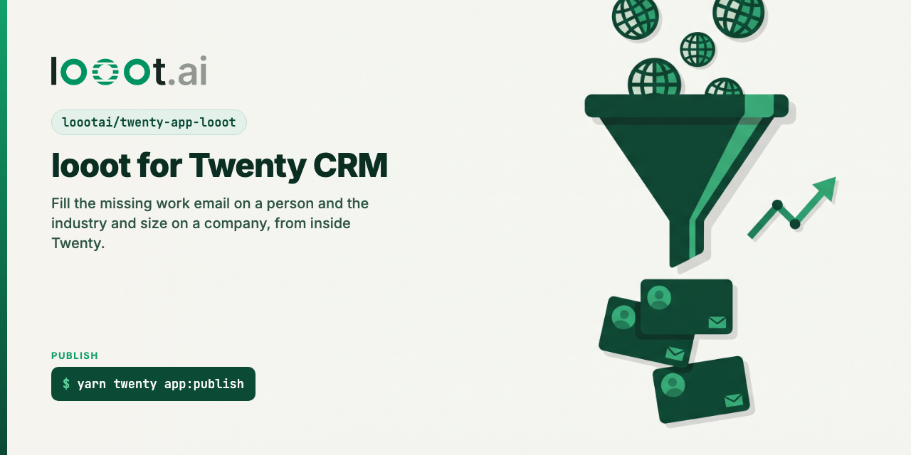

# twenty-app-looot

[](LICENSE) [](https://docs.looot.ai)

A [Twenty](https://twenty.com) CRM app for [looot](https://looot.ai). looot gives a workspace one key and
one prepaid balance for 4,200+ data endpoints from 300+ providers. This app uses three of its jobs to fill
gaps in people and company records.

Status: source only. Not published to npm and not in the Twenty marketplace. It builds, typechecks and
passes 25 unit tests, but it has not been synced into a Twenty server yet. See "Not checked yet".

## What it adds to a workspace

| What | Where in Twenty | looot job | Cost |
|---|---|---|---|
| Find work email with looot | pinned button and Cmd+K entry on selected people | `people.email.find` | from $0.003598 per call |
| Enrich with looot | pinned button and Cmd+K entry on selected companies | `company.enrich` | from $0.0019 per call |
| Find work email (looot) | workflow action and AI tool | `people.email.find` | from $0.003598 per call |
| Verify email (looot) | workflow action and AI tool | `people.email.verify` | from $0.00145 per call |
| Enrich company (looot) | workflow action and AI tool | `company.enrich` | from $0.0019 per call |
| Industry, Company size | two text fields on Company (`loootIndustry`, `loootCompanySize`) | | |

Prices are the cheapest provider of each job in the public catalog
(`GET https://api.looot.ai/v1/catalog/overview?depth=jobs`) on 2026-10-08. They change.

### The record buttons

- **Find work email with looot** reads the person's first and last name, their company's domain and name,
  and their LinkedIn link, then writes the email looot finds to the person's primary email. A person who
  already has an email is skipped before any call, so a second click costs nothing.
- **Enrich with looot** sends the company's domain and name and writes the industry and size into the two
  fields this app adds. It fills empty fields only and never overwrites a value.
- Both ask for confirmation first, run on at most 25 selected records per click, and end with one line:
  how many were updated, already filled, not found or failed, and what was spent.

### The workflow actions

Each action takes plain inputs (name, domain, email) and returns fields a later step can map: `email`,
`check`, `emailStatus`, `deliverable`, `industry`, `size`, plus `runId`, `status`, `costUsd` and
`provider`. They do not write to a record themselves; add an Update Record step after them. The same
three functions are exposed to Twenty's AI features as tools.

### How a lookup is sent

Every lookup is `POST https://api.looot.ai/v1/runs` with `endpointId` set to `job:<job id>`, `wait: 25`
and `fallback: true`, so looot tries the next provider of the same job when the first finds nothing and
charges only the attempts that ran. The idempotency key is `twenty-` plus the SHA-256 of the job, the
input and the UTC date: the same lookup twice in one day replays the first run and pays once. Values come
from looot's [normalized output](https://docs.looot.ai/concepts/normalized-output); when the provider
that answered has no field map the lookup counts as not found.

## Settings

| Variable | Required | What it is |
|---|---|---|
| looot agent token (`LOOOT_TOKEN`) | yes, secret | Create it in the looot dashboard under Settings, Agent tokens, with `catalog.read`, `runs.read`, `runs.execute` and `usage.read` |
| Max cost per lookup (`LOOOT_MAX_COST_USD`) | no | The most one lookup may spend across the providers looot tries, for example `0.05` |

The app's role can read and update people and companies. It cannot read other objects, delete records or
change settings. The health check reads `GET /v1/balance` and shows a banner when the token was revoked
or the balance is empty.

## Develop and test

Needs Node 24.5 or newer and Yarn 4 through Corepack.

```bash
corepack enable
yarn install --immutable
yarn lint
yarn typecheck
yarn test:unit          # 25 tests, looot and Twenty's REST API replaced by stand-ins
yarn twenty dev:build   # builds .twenty/output and manifest.json, no server needed
```

Output on 2026-10-08, Node 24.18.0:

```
Found 0 warnings and 0 errors.          (yarn lint)
 Test Files  2 passed (2)
      Tests  25 passed (25)             (yarn test:unit)
✓ Build succeeded (20 files)            (yarn twenty dev:build)
```

The built manifest lists 6 logic functions, 2 front components, 2 command menu items, 2 fields and 1 role.
No test calls looot, so no test spends credit.

`yarn test` is the integration test from the Twenty scaffold. It syncs the app into a running Twenty
server (`yarn twenty docker:start`, see [SETUP.md](SETUP.md)).

## Not checked yet

The app has not run inside Twenty. The integration test needs a local Twenty server in Docker, which was
not available where this was built. Before publishing, run `yarn twenty docker:start`, `yarn test` and
`yarn twenty dev`, then check in this order:

1. The sync accepts the manifest: the two Company fields, the role with object permissions, the two
   command menu items.
2. `GET /rest/people/{id}?depth=1` answers `{ data: { person } }` with `company.domainName.primaryLinkUrl`,
   and `PATCH /rest/people/{id}` accepts `{ emails: { primaryEmail } }`. `src/lib/records.ts` assumes both.
3. The buttons show on People and Companies, the confirmation opens, and the snackbar shows the summary.
4. One real lookup of each kind with your own looot token.

## Publish

Twenty lists an app in its marketplace when the npm package has the `twenty-app` keyword (it is in
`package.json`). The catalog syncs from npm every hour. Community apps show when a user turns off the
"Vetted only" filter. Docs read on 2026-10-08:
https://docs.twenty.com/developers/extend/apps/operations/publishing

```bash
npm login
yarn twenty app:publish
```

To claim the app in Twenty (needed to manage it from a workspace), the published version must carry npm
provenance from this public repo:

1. On npmjs.com open the package, Settings, Trusted Publisher, and register `loootai/twenty-app-looot`
   with the workflow `publish.yml`.
2. Bump `version` in `package.json`, push, then `gh workflow run publish.yml`. The workflow runs
   `yarn twenty app:publish` with provenance. It only runs by hand; pushing a tag does not publish.
3. In Twenty, Settings, Applications, Developer, Claim an application: enter `twenty-app-looot`, then
   Claim with GitHub as an owner of the `loootai` organization.

## Related

- [looot-zapier](https://github.com/loootai/looot-zapier), [looot-make](https://github.com/loootai/looot-make), [n8n-nodes-looot](https://github.com/loootai/n8n-nodes-looot): looot on automation tools.
- [looot-mcp](https://github.com/loootai/looot-mcp): the remote MCP server, `claude mcp add --transport http looot https://api.looot.ai/mcp`.
- [awesome-gtm](https://github.com/loootai/awesome-gtm): open-source GTM tools.

The top of this README is plain Markdown on purpose: Twenty shows it as the app's About tab, where raw
HTML appears as text.

MIT, copyright looot.
